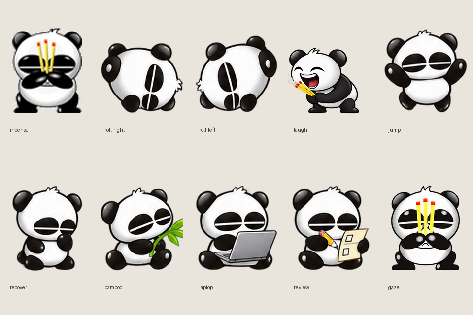

# 熊猫烧香 · Codex deskpet

以 `pandaincence.gif` 和 `pandaincense.jpg` 为参考的 Codex 原生桌宠，包含烧香、打滚、敲电脑、抱竹等待和检查清单。大笑时面向左上，双手持三炷香，上半身前后俯仰。原始文件原样保留；新动作使用内置 ImageGen 生成，提示词在 `assets/`。



## 安装原生版

下载 [最新版原生安装包（panda-incense-native.zip）](https://github.com/chiparon/panda-incense/releases/latest/download/panda-incense-native.zip)，将其中的 `panda-incense` 文件夹解压到：

- Windows：`%USERPROFILE%\.codex\pets\`
- macOS / Linux：`~/.codex/pets/`

重新打开 Codex，在宠物选择器中选择 **熊猫烧香**。原生版无需运行 Python。

也可以从 [Codex Pet Share](https://codexpetshare.com/pets/panda-incense) 预览、下载或安装：

```bash
npx codex-pet-share add panda-incense
```

**原生版的大笑使用 `waving` 动作槽。点击熊猫仍由 Codex 打开主窗口，不会触发大笑。**

## 可选：独立运行器（Windows）

双击 **start-pet.cmd**。熊猫出现在桌面右下角；单击捧腹大笑，拖动打滚，右键切换动作或退出。它读取本项目的 Codex 会话事件，工作时拿出 laptop 打字。点击动画结束后恢复工作状态。不会注册开机启动。

运行环境：Windows、Python 3.10+、Tkinter、Pillow。先执行 `python -m pip install -r requirements.txt`。

监控其他项目：`python deskpet.py --workspace "E:\其他项目"`。默认只监控本项目，不跟踪其他项目的工作。状态约每 2 秒刷新，只读 Codex 本地 SQLite/JSONL；不读取或发送账号凭据，不发送聊天内容。`runtime-status.json` 记录运行器状态。

## 动作与事件

| 事件 | 动作 | 本地运行器 | Codex 原生行（从 0 开始） |
| --- | --- | --- | --- |
| 待机 | 原图点头烧香 | 原 GIF 8 帧，100 ms/帧 | idle / 0，取 6 帧，原生时序 |
| 向右 / 向左拖动 | 打滚 | 8 + 8 帧 | running-right / 1、running-left / 2 |
| 单击 | 捧腹大笑 | 8 帧，播放 2.6 秒后恢复 | 原生点击不支持；大笑收录在 waving / 3 |
| 闲时活动 | 开心跳跃 | 随机穿插 | jumping / 4 |
| 中断 / 失败 | 擦汗振作 | turn_aborted / task_failed | failed / 5 |
| 等待输入 / 审批 | 抱竹等待 | 明确等待事件或 request_user_input 调用 | waiting / 6 |
| 正在工作 | 拿出 laptop 打字 | task_started；开盖后循环敲键盘 | running / 7 |
| 任务完成 | 检查清单、点赞 | task_complete；播放后回到待机 | review / 8 |
| 视线方向 | 手持香、转头 | 动作库 / 预览 | gaze / 9–10，共 16 帧 |

原生行顺序已按本机 Codex **26.1016.8622.0** 的安装代码核对。原生点击打开主窗口，`pet.json` 不能修改点击处理程序，所以“点击大笑”由本地运行器实现。没有修改 Codex 安装文件。原生 `waving` 也可在首次唤醒时触发；它不代表鼠标单击。

本地运行器监听 `task_started`、`task_complete`、`turn_aborted`，已用当前真实会话验证工作状态。等待/失败只有在会话记录明确事件时触发，不推测工具输出是否意味着失败。异常退出且缺少终止事件的会话可能仍显示工作；可右键暂停联动。原生包使用 Codex 自己的状态判断。

## 原生宠物包

`panda-incense-native.zip` 内包含 `panda-incense/pet.json` 与 `spritesheet.png`。

RGBA 精灵图 1536 × 2288；8 列 × 11 行；每格 192 × 208；`spriteVersionNumber: 2`。这是当前本地实现格式，版本升级时可能需要调整。原生播放器的工作动画会重复开盖；本地运行器开盖一次后持续打字。

## 文件

- `preview.html`：双击打开交互预览；按钮切换状态，点击熊猫测试大笑与恢复。
- `actions/`：完整动作 PNG 帧，9 组动作 + 16 视线帧，共 88 帧。
- `assets/actions-source.png`、`assets/gaze-source.png`：ImageGen 生成原稿。
- `state-map.json`：原生行与本地事件映射。
- `scripts/build_assets.py`：从参考 GIF 和生成原稿打包；只对原 GIF 的边界连通白底做导入色键，保留熊猫内部白色。
- `deskpet.py`：透明窗口和只读事件联动。
- `tests/`：事件流、项目筛选、部分 JSONL 行、真实 Tk 点击/拖动/恢复测试。

验证：`python -m unittest discover -s tests -v`；状态诊断：`python deskpet.py --status`。
